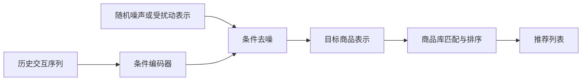

# 扩散模型的生成式推荐：中文导读、综述与研究路线

整理日期：2026-10-16。配套资料：[数据集与复现说明](diffusion-recommendation-datasets.md)。

本文面向推荐系统选题与入门复现，重点关注通过扩散生成用户偏好或下一物品的模型。文献事实依据下方论文与作者仓库；选题和实验安排为分析建议，尚未通过训练验证，不构成创新性或发表保证。

## 1. 一句话理解

扩散推荐学习“如何从被扰动的表示恢复用户偏好或目标商品”。在序列推荐中，模型以用户历史为条件，逐步生成下一件可能感兴趣的商品表示，再映射到商品库。它不要求使用大语言模型；去噪网络可以是 MLP 或 Transformer。[DreamRec](https://arxiv.org/abs/2310.20453)、[DiffuRec](https://arxiv.org/abs/2304.00686)

例如，历史是“跑鞋 → 运动手表 → 运动耳机”。模型生成的是一个符合该历史的目标向量，再寻找对应商品，而非凭空制造一件可购买的新商品。

上图是连续表示路线的概念示意，不表示所有模型都从纯高斯噪声开始；交互向量扩散可以从用户已有交互的扰动状态恢复。离散扩散则处理掩码或离散状态，而非直接采用连续高斯加噪。[DiffRec](https://hexiangnan.github.io/papers/sigir23-DiffRec.pdf)、[LLaDA-Rec](https://arxiv.org/abs/2511.06254)

## 2. 基本原理与训练、推理的区别

连续扩散的一种常见前向形式为：

$$x_t=\sqrt{\bar\alpha_t}x_0+\sqrt{1-\bar\alpha_t}\epsilon,\qquad \epsilon\sim\mathcal N(0,I).$$

其中，$x_0$ 可以是目标商品向量，$t$ 是噪声步，$\bar\alpha_t$ 控制保留多少原始信号。去噪器根据 $x_t$、时间步以及历史条件 $c$ 预测噪声或干净表示。不同论文使用不同目标与采样过程，不能把一个公式视为所有模型的完整实现。[DiffRec](https://hexiangnan.github.io/papers/sigir23-DiffRec.pdf)

- **训练阶段**：目标商品已知，可对其加噪，监督模型恢复。历史条件不得含该目标之后的行为。
- **推理阶段**：真实下一商品未知，模型使用可见历史生成表示，再进行商品匹配。
- **评估阶段**：比较目标商品排名、计算开销和分组效果；向量误差下降不等于排序一定改善，因此需直接测推荐指标。[PreferDiff](https://arxiv.org/abs/2410.13117)

评分、点击、观看本身是不同信号。使用评分数据训练隐式推荐时，需明确正反馈阈值；“未交互”不能自动解释为“不喜欢”。这属于实验定义，需写进配置和论文。

## 3. 三条主要路线

| 路线 | 扩散对象 | 如何得到推荐 | 阅读重点 |
|---|---|---|---|
| 交互向量扩散 | 用户对物品集合的交互向量，或压缩后的潜变量 | 恢复偏好分数并取 Top-K | 稀疏性、噪声强度、物品数带来的成本 |
| 连续商品表示扩散 | 下一物品的连续向量 | 与物品向量计算相似度或执行映射 | 条件建模、表示空间、生成与排名的一致性 |
| 离散 ID 扩散 | 物品 ID 或语义 ID 的离散 token | 迭代恢复 token 并解码成合法商品 | 编码方式、合法性、依赖关系与采样成本 |

对应代表分别为 [DiffRec](https://github.com/YiyanXu/DiffRec)、[DreamRec](https://github.com/YangZhengyi98/DreamRec)/[DiffuRec](https://github.com/WHUIR/DiffuRec)、[LLaDA-Rec](https://arxiv.org/abs/2511.06254)。扩散用于数据增强、图结构学习和个性化内容生成，也是更广义的“扩散模型用于推荐”，但不等同于直接生成推荐结果。[Lin 等综述](https://arxiv.org/abs/2409.05033)

## 4. 优先阅读的两篇专门综述

### 4.1 A Survey on Diffusion Models for Recommender Systems

- 作者：Jianghao Lin、Jiaqi Liu、Jiachen Zhu、Yunjia Xi、Chengkai Liu、Yangtian Zhang、Yong Yu、Weinan Zhang。
- 版本：arXiv 2024，页面显示 v2 更新于 2024-09-15；本文按预印本引用，不推定后续录用状态。
- [论文页面](https://arxiv.org/abs/2409.05033) · [PDF](https://arxiv.org/pdf/2409.05033) · [作者资源仓库](https://github.com/CHIANGEL/Awesome-Diffusion-for-RecSys)
- 组织方式：按扩散在推荐流程中的作用，区分数据工程与编码、推荐模型、内容呈现。
- 阅读价值：先明确自己要改进推荐流程中的哪个环节，再选择模型。

### 4.2 Diffusion Models in Recommendation Systems: A Survey

- 作者：Ting-Ruen Wei、Yi Fang。
- 版本：2025 年首发；本次核查的 arXiv v4 更新于 **2026-02-28**，共 39 页。这里引用该明确版本。
- [论文页面](https://arxiv.org/abs/2501.10548v4) · [PDF](https://arxiv.org/pdf/2501.10548v4) · [HTML 全文](https://arxiv.org/html/2501.10548v4) · [作者资源仓库](https://github.com/tingruew/DiffusionModels-In-RecSys)
- 组织方式：任务、数据模态与领域、可信目标与约束三个维度。
- 建议阅读：第 2 节扩散基础 → 第 3.2 节序列推荐 → 第 6 节数据集 → 第 7 节开放问题。
- 阅读价值：用任务定位相关方法，补齐效率、引导信息和可信推荐问题。

两篇综述分类角度互补。综述引用的结果不是统一重跑的排行榜，不能据不同论文中的数字直接判断模型优劣。

## 5. 代表论文与阅读顺序

| 顺序 | 论文 / 方法 | 已核实状态或版本 | 应理解的贡献 | 入口 |
|---|---|---|---|---|
| 1 | Diffusion Recommender Model / DiffRec | SIGIR 2023 | 对交互建模，并提供潜空间、时间信息等变体 | [论文](https://hexiangnan.github.io/papers/sigir23-DiffRec.pdf)、[代码与数据](https://github.com/YiyanXu/DiffRec) |
| 2 | Generate What You Prefer / DreamRec | NeurIPS 2023 | 历史条件引导目标物品表示生成 | [论文](https://arxiv.org/abs/2310.20453)、[代码与数据](https://github.com/YangZhengyi98/DreamRec) |
| 3 | DiffuRec: A Diffusion Model for Sequential Recommendation | TOIS，在线年份 2023、卷期 2024 | 目标向量加噪与恢复，映射到离散物品 | [论文](https://arxiv.org/abs/2304.00686)、[代码](https://github.com/WHUIR/DiffuRec) |
| 4 | Preference Diffusion for Recommendation / PreferDiff | ICLR 2025 | 针对个性化排序设计扩散优化目标 | [论文与作者代码入口](https://arxiv.org/abs/2410.13117) |
| 5 | On Efficiency-Effectiveness Trade-off of Diffusion-based Recommenders / TA-Rec | NeurIPS 2025 | 相邻去噪步一致性与自适应偏好对齐 | [会议页面与全文入口](https://papers.nips.cc/paper_files/paper/2025/hash/8573e433d2ff235a41c64e7e1d37c7a5-Abstract-Conference.html) |
| 6 | LLaDA-Rec: Discrete Diffusion for Parallel Semantic ID Generation in Generative Recommendation | arXiv，2025-11-09 首发；这里不推定录用状态 | 双向建模、并行编码、双层掩码与适配解码 | [论文](https://arxiv.org/abs/2511.06254) |

补充：[iDreamRec / Generate and Instantiate What You Prefer](https://arxiv.org/abs/2410.13428) 研究文本引导的序列推荐。若考虑结合 LLM、商品描述或自然语言意图，应先读它，避免把“加入文本条件”当作全新的贡献。

另见 [Eval4DiRec](https://github.com/wangcong2001/Eval4DiRec) 的统一评估资源。复现工作有助于检查调参和协议是否公平，不能据论文自报提升直接断言扩散总是优于非扩散方法。

## 6. 值得检验的研究问题

以下是选题假设，不是已经证实的空白。

### A. 连续生成与商品映射的误差

问题：生成向量的重建误差改善，是否对应正确商品排名改善？误差是否集中在长尾商品或表示密集区域？

第一步只做诊断：记录目标向量误差、目标商品排名、邻域密度、商品流行度。再讨论商品邻域约束或排序对齐。PreferDiff 已有偏好对齐工作，简单增加排序损失不足以构成新贡献。

### B. 固定计算预算下的个性化采样

问题：相同总预算下，应给某个用户更多去噪步，还是生成更多候选样本？什么用户会受益？

需与固定步数、固定采样数、简单停止规则和 TA-Rec 等相关方法比较。报告端到端延迟，包含商品匹配；仅减少去噪步数不等于在线系统更快。

### C. 多兴趣覆盖与生成重复

问题：重复采样是否覆盖多个有效兴趣，还是不断映射到同一批热门商品？

应在准确率相近时比较覆盖率、列表内多样性和重复率。单一下一物品标签不足以完整证明全部生成候选都符合偏好；需说明离线评估的局限。

### D. 离散生成的合法性与新商品适应

问题：生成语义 ID 是否对应现有商品？约束解码是否过度偏向已有热门编码？新增商品如何进入编码体系？

可测合法 ID 比例、冷启动效果与编码维护成本。LLaDA-Rec 已涉及并行编码和解码，需进一步查重。作为首次项目，编码器、生成器、解码器同时变化会增加归因难度。

## 7. 推荐的起步实验

1. 先读两篇综述的分类与序列推荐部分，再读 DreamRec、DiffuRec。
2. 选一个作者提供的预处理数据版本，按仓库协议复现。单独记录下载日期、提交版本、数据切分和 ID 映射。
3. 建立同协议的流行度、SASRec 等基线，以及至少一个扩散基线。一般推荐和序列推荐不能不加区分地混成一个榜单。
4. 保持验证集、候选池、历史过滤、调参预算一致。区分全物品排序与采样负例评估。
5. 先做步数扫描、采样数扫描、流行度与序列长度分组；一次只选择一个稳定失败现象作为研究对象。
6. 模型选择只用验证集，最终测试采用多个随机种子；报告均值与波动、训练成本和推理延迟。

优先建议：用小规模数据打通流程，再用论文原始基准验证。MovieLens-1M 适合流程检查，但它是评分数据，将评分时间序列当作消费顺序需要明确这一限制。不要承诺扩散在任意数据上都更好。

## 8. 检索方法与局限

本次为定向文献导读，非穷尽式系统综述。检索时间为 2026-10-16；关键词包括 “diffusion models recommender systems survey”、模型名称和 “diffusion recommendation efficiency”。通过 arXiv、会议官网、作者 GitHub 和数据发布机构交叉核对题名、版本、资源入口。排除只有聚合站摘要且无法确认原始出处的条目。

本文采用 AI 辅助检索与整理，并核对上述主源；没有重跑模型或下载验证所有数据包。最新论文的预印本状态与资源链接可能变化；没有把“代码公开”视为“已可在当前机器成功复现”。算力需求应由具体物品数、序列长度、隐藏维度、采样步数和批量大小实测，不给出统一显存承诺。
