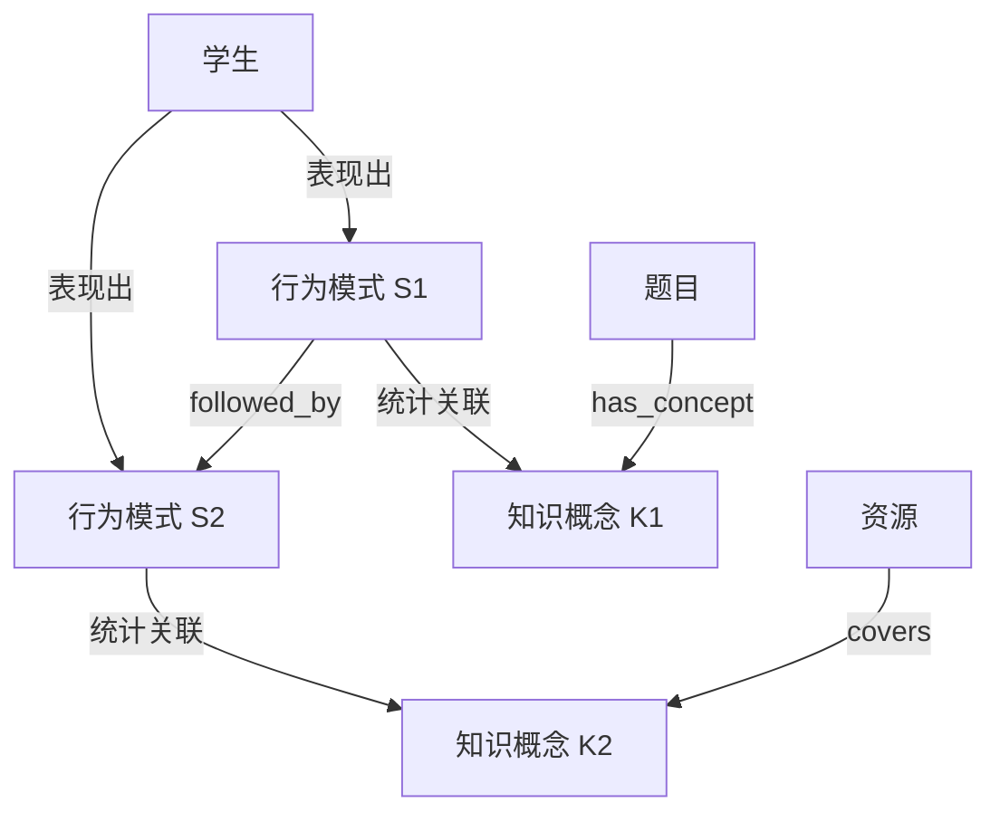
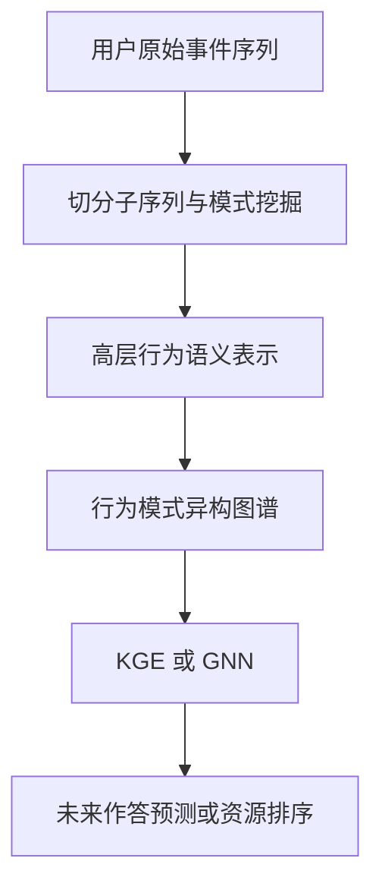

# 从用户行为序列出发构建知识图谱：37 篇文献与研究路线

整理日期：2026-11-26。承接[教育行为序列推荐 25 篇文献](2026-11-26-educational-behavior-sequence-recommendation-papers.md)和[LBKT、EdNet 学习周报](2026-11-24-lbkt-ednet-weekly-notes.md)。

> 本文归档上一轮广泛检索的 37 篇候选论文及摘要概述、出处、链接和讨论内容。此次提交未重新逐篇访问出版方核验，所列书目信息及中文概述沿用检索记录，正式引用前须核对原文、作者、年份和 DOI；不是官方摘要全文翻译。预印本、海报、书籍章节及一般图模型不等同于正式期刊知识图谱论文。2026 年条目尤其需核对出版状态。

## 检索分类

| 类别 | 数量 | 节点与关系 |
|---|---:|---|
| 时序知识图谱 | 5 | 实体、时间、交互与语义关系 |
| 潜在意图图 | 5 | 意图及意图间转移 |
| 多行为图 | 8 | 用户、物品、行为类型、超边 |
| 教育知识结构 | 11 | 学生、题目、知识概念、候选依赖 |
| 事件知识图谱及抽象 | 8 | 原始事件、对象、高层活动及过程关系 |
| 合计 | 37 | |

核心区分：使用已有图谱、行为增强图谱、从日志自动构图、从行为推断潜在语义或先修关系，是不同研究任务。

## 一、行为驱动知识图谱与时序知识图谱

### 1. User Behavior Enriched Temporal Knowledge Graphs for Sequential Recommendation

- **出处**：WSDM 2024
- **原文入口**：[DOI / 出版方 / 公开论文](https://doi.org/10.1145/3616855.3635762)
- **中文摘要概述**：从历史用户序列提取动态关联，补充静态知识图谱，形成用于序列推荐的时序知识图谱。
- **研究关联**：直接参考行为增强知识图谱；并非完全从零构图。

### 2. Temporal knowledge graph recommendation with sequence-aware and path reasoning

- **出处**：Data & Knowledge Engineering，2026 年出版周期
- **原文入口**：[DOI / 出版方 / 公开论文](https://www.sciencedirect.com/science/article/pii/S0169023X2500117X)
- **中文摘要概述**：联合组织静态知识关系和动态用户—物品交互，以序列感知和路径推理刻画动态偏好。
- **研究关联**：时序关系与推荐解释。

### 3. Building and exploiting spatial–temporal knowledge graph for next POI recommendation

- **出处**：Knowledge-Based Systems，2022
- **原文入口**：[DOI / 出版方 / 公开论文](https://www.sciencedirect.com/science/article/pii/S0950705122010449)
- **中文摘要概述**：利用移动签到历史构建时空知识图谱，融合长期偏好和短期行为预测下一地点。
- **研究关联**：连续日志如何转化为时空语义边；非教育场景。

### 4. CTKGRec: A context-aware temporal knowledge graph reasoning model for next POI recommendation

- **出处**：Expert Systems with Applications，2026
- **原文入口**：[DOI / 出版方 / 公开论文](https://www.sciencedirect.com/science/article/pii/S0957417425028404)
- **中文摘要概述**：将签到行为组织为情境感知时序图谱，通过图推理预测下一地点。
- **研究关联**：重复行为、周期及情境的表达。

### 5. Context-Aware Knowledge Graph Learning for Point-of-Interest Recommendation

- **出处**：ISPRS International Journal of Geo-Information，2026
- **原文入口**：[DOI / 出版方 / 公开论文](https://www.mdpi.com/2220-9964/15/1/14)
- **中文摘要概述**：结合签到序列、地点和社交信息形成知识图谱，以时序连边及图表示学习完成地点推荐。
- **研究关联**：节点、关系类型和时序边定义。

## 二、潜在意图与高层行为模式图

### 6. Intention-Aware Sequential Recommendation With Structured Intent Transition

- **出处**：IEEE Transactions on Knowledge and Data Engineering，2022（ISRec）
- **原文入口**：[DOI / 出版方 / 公开论文](https://doi.org/10.1109/TKDE.2021.3050571)
- **中文摘要概述**：从历史交互上下文学习潜在意图，在意图图上建模结构化的意图转移，辅助预测未来意图和物品。
- **研究关联**：重点精读：将原始交互提升到意图层构图。

### 7. Modeling category and multi-level user intentions for session-based recommendation

- **出处**：Engineering Applications of Artificial Intelligence，2025
- **原文入口**：[DOI / 出版方 / 公开论文](https://www.sciencedirect.com/science/article/abs/pii/S0952197625012497)
- **中文摘要概述**：通过多层次意图图和类别图描述会话中不同粒度的用户目标，涉及层次划分与合并。
- **研究关联**：行为片段如何形成高层节点。

### 8. TIDRec: Mining Time-Evolving Intent Dynamics from timestamped interaction logs for data-intensive sequential recommendation

- **出处**：Information Systems，2026
- **原文入口**：[DOI / 出版方 / 公开论文](https://www.sciencedirect.com/science/article/pii/S0306437926001195)
- **中文摘要概述**：从带时间戳的交互日志学习意图动态，通过时序意图记忆图描述状态演化。
- **研究关联**：动态行为模式表示与维护。

### 9. Hypergraph-based Temporal Modelling of Repeated Intent for Sequential Recommendation

- **出处**：2024 公开论文；正式发表出处待核
- **原文入口**：[DOI / 出版方 / 公开论文](https://openreview.net/forum?id=t0q7KbmB7o)
- **中文摘要概述**：利用超图建模重复意图及多个行为之间的高阶时间关联。
- **研究关联**：区分重复物品与重复意图；不能视为已确认正式发表。

### 10. Integrating user short-term intentions and long-term preferences in heterogeneous hypergraph networks for sequential recommendation

- **出处**：Information Processing & Management，2024
- **原文入口**：[DOI / 出版方 / 公开论文](https://www.sciencedirect.com/science/article/pii/S0306457324000402)
- **中文摘要概述**：借助异构超图结合短期意图与长期偏好，表达多个实体之间的高阶关联。
- **研究关联**：局部片段和全局历史的联合建模。

## 三、多类型行为图、微行为图与超图

### 11. Multi-Behavior Sequential Recommendation with Temporal Graph Transformer

- **出处**：2022 预印本（TGT）
- **原文入口**：[DOI / 出版方 / 公开论文](https://arxiv.org/abs/2206.02687)
- **中文摘要概述**：将不同类型交互组织为时序图，利用图 Transformer 学习跨行为动态依赖。
- **研究关联**：多类型操作的时间依赖；非严格知识图谱。

### 12. Collaborative Sequential Recommendations via Multi-view GNN-transformers

- **出处**：ACM，2024；具体卷期待核
- **原文入口**：[DOI / 出版方 / 公开论文](https://doi.org/10.1145/3649436)
- **中文摘要概述**：汇总历史序列构建全局物品依赖图，以多视图 GNN 与 Transformer 联合建模协同与个体序列。
- **研究关联**：群体行为转移图和个体表示的结合。

### 13. Generic User Behavior: A User Behavior Similarity-Based Recommendation Method

- **出处**：Big Data，2023 在线发表
- **原文入口**：[DOI / 出版方 / 公开论文](https://doi.org/10.1089/big.2022.0260)
- **中文摘要概述**：从交互事实提取三元组，构建实体交互知识图谱（EIKG），通过知识图谱嵌入和链接预测推荐。
- **研究关联**：从原始交互到三元组的直接参考。

### 14. Sequential recommendation model integrating micro-behaviors and attribute enhancement

- **出处**：Neurocomputing，2023
- **原文入口**：[DOI / 出版方 / 公开论文](https://www.sciencedirect.com/science/article/pii/S0925231223005167)
- **中文摘要概述**：结合微行为交互及属性关联信息增强序列推荐表示。
- **研究关联**：比普通点击/购买更细粒度的行为建模。

### 15. Hypergraph-enhanced multi-interest learning for multi-behavior sequential recommendation

- **出处**：Expert Systems with Applications，2024/2025
- **原文入口**：[DOI / 出版方 / 公开论文](https://www.sciencedirect.com/science/article/pii/S0957417424013642)
- **中文摘要概述**：利用超图学习多行为交互中的多维兴趣与高阶依赖。
- **研究关联**：比较超边与外积的高阶建模能力。

### 16. Causal cascading convolution networks for multi-behavior sequential recommendation

- **出处**：Information Sciences，2025
- **原文入口**：[DOI / 出版方 / 公开论文](https://www.sciencedirect.com/science/article/pii/S0020025525006164)
- **中文摘要概述**：利用级联卷积与行为图关系建模多类型序列依赖。
- **研究关联**：行为依赖设计；模型使用因果术语不等同于观察数据已证实因果。

### 17. Continuous-Time Sequential Recommendation with Temporal Graph Collaborative Transformer

- **出处**：2021 公开论文；正式出处待核
- **原文入口**：[DOI / 出版方 / 公开论文](https://arxiv.org/abs/2108.06625)
- **中文摘要概述**：利用连续时间用户—物品交互图及 Transformer 表达时间动态与协同信号。
- **研究关联**：非均匀事件时间间隔建模。

### 18. CaSe4SR: Using category sequence graph to augment session-based recommendation

- **出处**：Knowledge-Based Systems，2020/2021
- **原文入口**：[DOI / 出版方 / 公开论文](https://www.sciencedirect.com/science/article/pii/S0950705120306870)
- **中文摘要概述**：从物品序列与类别序列构图，以类别层信息增强会话推荐。
- **研究关联**：从低层对象到高层类别的图抽象。

## 四、教育知识结构发现与知识追踪图

### 19. Graph-based Knowledge Tracing: Modeling Student Proficiency Using Graph Neural Networks

- **出处**：Web Intelligence，2021（GKT；早期会议工作 2019）
- **原文入口**：[DOI / 出版方 / 公开论文](https://doi.org/10.3233/WEB-210458)
- **中文摘要概述**：从学生答题序列构建知识概念图，包括统计概念转移概率和学习潜在关联的方法，用 GNN 追踪学生状态。
- **研究关联**：数据驱动的知识关联图；转移不是先修因果关系。

### 20. Joint Discovery of Skill Prerequisite Graphs and Student Models

- **出处**：EDM 2016（COMMAND）
- **原文入口**：[DOI / 出版方 / 公开论文](https://eric.ed.gov/?id=ED592684)
- **中文摘要概述**：利用学生作答数据联合发现技能先修图和学生模型，以贝叶斯网络描述依赖关系。
- **研究关联**：从学生表现推断知识结构。

### 21. Knowledge Structure Enhanced Graph Representation Learning Model for Attentive Knowledge Tracing

- **出处**：International Journal of Intelligent Systems，2022（KSGKT）
- **原文入口**：[DOI / 出版方 / 公开论文](https://doi.org/10.1002/int.22763)
- **中文摘要概述**：比较从学生作答数据发现知识结构的多种方法，并在注意力知识追踪中利用结构信息；上一轮摘要记录为八种方法，具体列表需核原文。
- **研究关联**：自动构图方法的对照研究。

### 22. Discovering Prerequisite Relationships Between Knowledge Components from an Interpretable Learner Model

- **出处**：EDM 2023（海报论文）
- **原文入口**：[DOI / 出版方 / 公开论文](https://educationaldatamining.org/EDM2023/proceedings/2023.EDM-posters.55/index.html)
- **中文摘要概述**：从可解释学习者模型探索知识组件之间的候选先修关系。
- **研究关联**：先修关系发现与解释。

### 23. Improving Knowledge Tracing via a Heterogeneous Information Network Enhanced by Student Interactions

- **出处**：Expert Systems with Applications，2023
- **原文入口**：[DOI / 出版方 / 公开论文](https://www.sciencedirect.com/science/article/pii/S0957417423013556)
- **中文摘要概述**：构建学生、习题和知识点的异构信息网络，利用作答交互推断习题间隐性关联。
- **研究关联**：学生交互增强异构图。

### 24. Enhancing Heterogeneous Information Networks Through Student Interactions for Knowledge Tracing

- **出处**：Information Sciences，2025（HSKT）
- **原文入口**：[DOI / 出版方 / 公开论文](https://www.sciencedirect.com/science/article/pii/S0020025525011995)
- **中文摘要概述**：使用学生交互增强异构网络及知识追踪表示，相关讨论涉及元路径和图对比学习。
- **研究关联**：多关系图与对比学习；详细模块待全文核对。

### 25. HHSKT: A Learner–Question Interactions Based Heterogeneous Graph Neural Network Model for Knowledge Tracing

- **出处**：Expert Systems with Applications，2023
- **原文入口**：[DOI / 出版方 / 公开论文](https://www.sciencedirect.com/science/article/pii/S0957417422023521)
- **中文摘要概述**：基于学习者—习题交互构建异构图，获得高阶习题及知识技能表示。
- **研究关联**：学生与习题关系的异构传播。

### 26. SGKT: Session Graph-based Knowledge Tracing for Student Performance Prediction

- **出处**：Expert Systems with Applications，2022
- **原文入口**：[DOI / 出版方 / 公开论文](https://www.sciencedirect.com/science/article/pii/S0957417422009770)
- **中文摘要概述**：将学生学习会话转化为图结构以建模历史过程和知识状态。
- **研究关联**：局部会话图的构建。

### 27. SQGKT: Student-Question Interaction Graph-based Knowledge Tracing

- **出处**：Expert Systems with Applications，2026
- **原文入口**：[DOI / 出版方 / 公开论文](https://www.sciencedirect.com/science/article/pii/S0957417425027915)
- **中文摘要概述**：结合学生—习题与习题—技能图进行知识追踪，考虑学习能力与尝试、提示等行为信息。
- **研究关联**：多行为统计与知识结构融合。

### 28. Extracting Causal Relations in Deep Knowledge Tracing

- **出处**：EDM 2025（海报/演示）
- **原文入口**：[DOI / 出版方 / 公开论文](https://educationaldatamining.org/edm2025/proceedings/2025.EDM.poster-demo-papers.266/index.html)
- **中文摘要概述**：从知识追踪模型提取习题关联，并以有向无环图表达候选依赖。
- **研究关联**：候选因果结构需要独立验证。

### 29. Hierarchical Graph Attention Knowledge Tracing and Personalized Recommendation for Computer Courses

- **出处**：Scientific Reports，2026
- **原文入口**：[DOI / 出版方 / 公开论文](https://www.nature.com/articles/s41598-026-51429-7)
- **中文摘要概述**：结合学生交互记录及多层知识标签，利用层次图结构开展知识追踪和个性化推荐。
- **研究关联**：层次知识结构与下游推荐。

## 五、事件知识图谱、过程挖掘与事件抽象

### 30. What is Event Knowledge Graph: A Survey

- **出处**：IEEE Transactions on Knowledge and Data Engineering，2023
- **原文入口**：[DOI / 出版方 / 公开论文](https://doi.org/10.1109/TKDE.2022.3180362)
- **中文摘要概述**：综述事件中心知识图谱的事件表示、关系、知识抽取、构建与应用。
- **研究关联**：建立 EKG 概念体系；综述而非推荐模型。

### 31. Multi-Dimensional Event Data in Graph Databases

- **出处**：Journal on Data Semantics，2021
- **原文入口**：[DOI / 出版方 / 公开论文](https://doi.org/10.1007/s13740-021-00122-1)
- **中文摘要概述**：将多维事件日志转化为图数据库结构，保留事件、关联实体及不同实体视角的直接后继关系。
- **研究关联**：适合 EdNet 多对象日志构图。[开源代码](https://github.com/multi-dimensional-process-mining/graphdb-eventlogs)。

### 32. Process Mining over Multiple Behavioral Dimensions with Event Knowledge Graphs

- **出处**：Process Mining Handbook，2022（书籍章节）
- **原文入口**：[DOI / 出版方 / 公开论文](https://doi.org/10.1007/978-3-031-08848-3_9)
- **中文摘要概述**：利用 EKG 支持多个实体视角的行为过程挖掘，避免仅用单一事件序列表达复杂过程。
- **研究关联**：学生、题目、知识点、资源等多对象过程。

### 33. Aggregating Event Knowledge Graphs for Task Analysis

- **出处**：2023 会议论文；会议全称待核
- **原文入口**：[DOI / 出版方 / 公开论文](https://doi.org/10.1007/978-3-031-27815-0_36)
- **中文摘要概述**：聚合底层事件知识图谱，保留任务实例这一中间抽象层，分析不同执行模式。
- **研究关联**：重点精读：事件抽象与高层行为节点。

### 34. Construction and Application of the User Behavior Knowledge Graph in Software Platforms

- **出处**：Journal of Web Engineering，2021
- **原文入口**：[DOI / 出版方 / 公开论文](https://journals.riverpublishers.com/index.php/JWE/article/view/5879)
- **中文摘要概述**：研究软件平台用户行为知识的提取、表示及图谱构建应用。
- **研究关联**：用户行为知识图谱的直接参考。

### 35. An Object-Centric Approach to Multi-Entity Educational Process Mining

- **出处**：Decision Analytics Journal，2026
- **原文入口**：[DOI / 出版方 / 公开论文](https://doi.org/10.1016/j.dajour.2026.100724)
- **中文摘要概述**：把面向对象的过程挖掘用于教育过程，组织学习者、学习资源和测评等多实体交互。
- **研究关联**：重点检查教育日志到 EKG 的实际构建过程。

### 36. A Multi-View Predictive Student Modeling Framework with Interpretable Causal Graph Discovery for Collaborative Learning Analytics

- **出处**：EDM 2025（长文）
- **原文入口**：[DOI / 出版方 / 公开论文](https://educationaldatamining.org/EDM2025/proceedings/2025.EDM.long-papers.135/index.html)
- **中文摘要概述**：对学生对话和游戏操作进行事件抽象，以带约束序列挖掘和多视图预测发现行为模式及候选因果图，分析学习结果。
- **研究关联**：重点精读：行为抽象→模式→图→预测；不是直接推荐。

### 37. A Domain-Driven Framework to Analyze Learning Dynamics in MOOCs through Event Abstraction

- **出处**：Applied Sciences，2023
- **原文入口**：[DOI / 出版方 / 公开论文](https://doi.org/10.3390/app13053039)
- **中文摘要概述**：利用领域知识将底层 MOOC 日志抽象为高层活动，再通过过程挖掘分析学习动态。
- **研究关联**：细粒度操作到高层语义的预处理。

## 六、优先精读顺序

| 优先级 | 编号 | 核心问题 |
|---|---|---|
| S | 1. User Behavior Enriched TKG | 历史序列怎样生成图谱新增关系 |
| S | 6. ISRec | 意图节点如何发现及转移 |
| S | 36. Multi-View Student Modeling | 原始行为抽象、模式挖掘、图关系发现 |
| S | 35. Object-Centric Educational Process Mining | 多实体教育事件图 |
| A | 33. Aggregating EKG | 底层事件聚合为高层任务 |
| A | 19. GKT | 从作答序列发现知识结构 |
| A | 30. EKG Survey | 事件知识图谱理论 |
| A | 7. Multi-level User Intentions | 多粒度意图构图 |
| A | 11. TGT | 多行为动态依赖 |
| A | 21. KSGKT | 数据驱动知识结构发现方法比较 |

先读 1、6、36，分别解决行为驱动构图、潜在语义发现、教育行为模式验证三个问题。优先级按研究相关性而非影响因子排序。

## 七、面向 EdNet 的构图方式比较

原始用户事件序列（假设示例）：改选 → 提交 → 查看解析 → 播放 → 暂停 → 重播。

### 1. 行为转移图

节点为动作类型，边为直接后继关系，可用频数或条件概率作为权重。

$$
P(a_j\mid a_i)=\frac{N(a_i\to a_j)}{\sum_k N(a_i\to a_k)}
$$

优点是简单；缺点是压缩为两两关系后可能丢失高阶顺序和上下文。应控制平台强制执行的流程。

### 2. 高层行为模式图

将原始用户序列按滑动窗口、时间间隔或可靠边界切分，利用 n-gram、PrefixSpan 或表示学习发现模式。示例：S1 = 改选→提交→查看解析；S2 = 播放→暂停→重播。节点是模式而非单次事件，边可表示 followed_by、co_occurs、similar_to 等可定义关系。反馈学习、重复收听只是候选解释，不能直接当作真实学习需求。

### 3. 行为模式—知识概念异构图

可构造 (U, exhibits, S1)、(S1, associated_with, K1)、(Q, has_concept, K1) 等三元组。学生事件与题目/资源、KC 的对应必须通过真实 item_id、时间戳及 Contents 元数据核实。关系应区分观察事实与统计推断，并保留时间、频次、置信度及证据来源；避免把同一学生所有历史事件无差别压缩成静态边。

### 4. 从行为发现知识概念关联

例如比较 K1 上的历史行为模式与后来 K2 上的作答结果。控制过去能力、题目难度、平台推荐路径和知识点出现频次后，才可以讨论统计依赖是否具有额外预测价值。高转移概率不能证明先修关系；观察性数据不能直接证明因果。

## 八、候选研究路线与实验

- **第一阶段**：统计操作频次、模式覆盖率、跨学生/跨时间稳定性；检查 EdNet KT3/KT4 真实字段和知识标签映射。
- **第二阶段**：对照原始序列 GRU/Transformer、行为转移图、行为模式图、行为模式—知识概念异构图；在相同样本与预测时点比较。
- **第三阶段**：按需加入 LBKT 式行为因子、两两/高阶外积、对比学习。外积不负责顺序；对比学习不自动赋予语义；KGE 学习实体及关系表示，GNN 聚合邻域信息。不要预设复杂模块必然有效。
- **第四阶段**：对未来答题预测使用 AUC、RMSE、ACC；对下一资源排序使用 Recall@K、NDCG@K 等，另外检验模式可解释性与独立未来学习表现。推荐目标与真实学习增益并不等价。
- **数据泄漏控制**：模式字典、图边统计、嵌入训练使用训练数据；预测时仅允许利用当时可见事件，重叠窗口不能跨集合泄漏；异构图构建不能引入未来答题结果。

暂定方向：**行为模式驱动的教育知识图谱构建与序列推荐（Behavior Pattern-driven Educational Knowledge Graph Construction and Sequential Recommendation）**。现阶段为研究假设而非已验证创新点。严格知识图谱与普通图/超图、过程模型应分别命名和评价。

## 九、后续检索关键词

| 英文关键词 | 方向 |
|---|---|
| Behavior-driven Knowledge Graph Construction | 行为驱动构图 |
| User Behavior Enriched Knowledge Graph | 行为增强图谱 |
| Event Knowledge Graph Construction from Event Logs | 日志到事件图谱 |
| Latent Intent Graph Sequential Recommendation | 潜在意图图 |
| Behavioral Pattern Graph Mining | 行为模式图挖掘 |
| Event Abstraction | 事件抽象 |
| Data-driven Knowledge Structure Discovery | 数据驱动知识结构发现 |
| Object-centric Educational Process Mining | 教育多对象过程挖掘 |
| Learning Behavior Knowledge Graph | 学习行为知识图谱 |

本次归档共 37 篇。没有下载或上传论文全文，没有运行实验，未确认所有候选文献的准确卷期、摘要细节和创新性。下一步逐篇核对输入字段、节点/边生成算法、是否使用外部 KG、时间切分、训练任务与输出。
